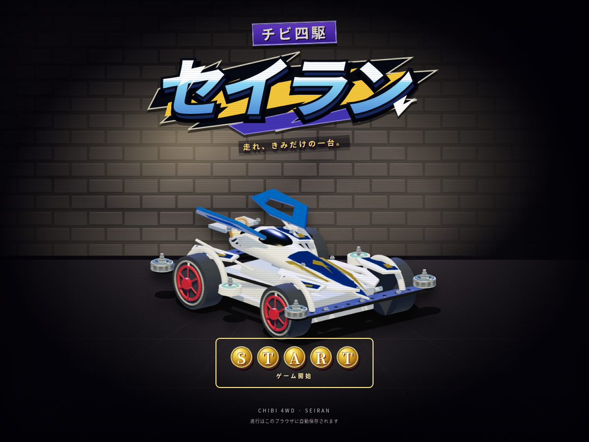

# TINY DRIVE — システム構成

```mermaid
flowchart LR
  subgraph Development[開発・ビルド]
    direction TB
    Source["TypeScript / React<br/>ソースコード・画像・音源"]
    Toolchain["Node.js / pnpm<br/>Viteでビルド"]
    Dist["dist/<br/>HTML・CSS・JavaScript・静的アセット"]
    Check["TypeScriptで型チェック<br/>tsx + Node.js Test Runnerでロジック検証"]
    Source --> Toolchain --> Dist
    Source --> Check
  end

  Hosting["Cloudflare Workers Static Assets<br/>SPA配信・Workers Preview"]

  subgraph Browser[ユーザーのブラウザ]
    direction TB
    subgraph Presentation[ゲーム画面]
      direction LR
      UI["React 19<br/>画面切替・会話・ショップ・設定"]
      World["Phaser 3<br/>街・店内の2D探索・入力・当たり判定"]
      Race["Three.js / WebGL<br/>3Dレース・マシンプレビュー"]
    end
    subgraph GameServices[ゲーム状態・サービス]
      direction LR
      Store["Zustand 5<br/>進行・所持品・装備の状態管理"]
      Logic["TypeScriptのゲームロジック<br/>走行物理・購入・大会・報酬"]
      Data["src/data/<br/>パーツ・コース・マップ・人物データ"]
      Save["セーブ処理<br/>検証・自動保存・復元"]
      DB[("IndexedDB<br/>同一ブラウザ・オリジン内のセーブ")]
      Audio["Web Audio API<br/>BGM・効果音"]
    end
    UI --> World
    UI --> Race
    UI <--> Store
    World <--> Store
    Race <--> Store
    Store --> Logic
    Logic --> Data
    Store <--> Save
    Save <--> DB
    UI --> Audio
    Race --> Audio
  end

  Dist -->|Wranglerでアップロード| Hosting
  Hosting -->|HTTPSでアプリ・アセットを配信| UI

  classDef build fill:#eef2f7,stroke:#596d8d,color:#263445,stroke-width:1.5px;
  classDef hosting fill:#fff4e9,stroke:#e66a16,color:#74320b,stroke-width:2px;
  classDef ui fill:#f0f7ff,stroke:#486a98,color:#203b5a,stroke-width:1.5px;
  classDef service fill:#eff9ed,stroke:#3b8c35,color:#245a20,stroke-width:1.5px;
  classDef store fill:#f5f0ff,stroke:#7142c8,color:#382269,stroke-width:1.5px;
  class Source,Toolchain,Dist,Check build;
  class Hosting hosting;
  class UI,World,Race ui;
  class Store,Logic,Data,Save,DB,Audio service;
  style Development fill:#ffffff,stroke:#596d8d,stroke-width:2px;
  style Browser fill:#ffffff,stroke:#263445,stroke-width:2px;
  style Presentation fill:#f8fbff,stroke:#486a98,stroke-width:1.5px;
  style GameServices fill:#fbfff9,stroke:#3b8c35,stroke-width:1.5px;
```

| 区分 | 使用技術 | 役割・構成 |
| --- | --- | --- |
| 言語 | TypeScript 5.9 | UI・描画・ゲームロジックを型付きで実装。ロジックは描画から分離 |
| UI | React 19 / React DOM 19 / CSS | 画面切替、会話、購入・装備・設定などのUI |
| 2D描画 | Phaser 3.90 | 街・店内の探索、キャラクター描画、移動入力、当たり判定 |
| 3D描画 | Three.js 0.186 / WebGL | レース、車体・パーツの3Dモデル、装備プレビュー |
| 状態管理 | Zustand 5 | 所持金・所持品・装備・イベント・大会進行をブラウザのメモリ上で管理 |
| データ定義 | TypeScript（`src/data/`） | パーツ、コース、マップ、人物などをコード内のデータとして管理 |
| 永続化 | IndexedDB | `tiny-drive-save` DBの`saves`ストアへセーブ。別端末・別オリジンとの同期なし |
| 音声 | Web Audio API | BGMの読み込み・再生、走行音・操作音などの効果音 |
| 静的アセット | WebP / 音源パッケージ | 人物・背景・商品画像とBGMをアプリとともに配信 |
| 開発・ビルド | Node.js 22.12以降 / pnpm 10.18.3 / Vite 7 | 依存管理、開発サーバー、`dist/`への本番ビルド |
| 検証 | TypeScript / tsx / Node.js Test Runner | 型チェックと`src/game/*.test.ts`のゲームロジックテスト |
| 配信・デプロイ | Cloudflare Workers Static Assets / Wrangler 4 | `dist/`の静的配信、SPAフォールバック、Workers Previewへのデプロイ |
| サーバー・DB | 独自API・Cloudflare D1は未導入 | 現在はブラウザ内でゲーム処理とセーブを完結。D1バインディングなし |
