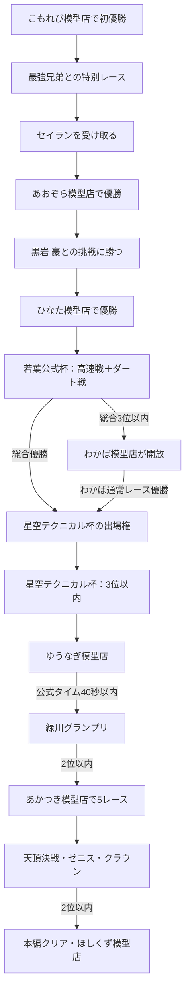

# セイラン ストーリーと進行条件

本書は、ゲーム本編の物語と、店・公式大会の解放条件をまとめたものです。現在の実装に基づき、攻略上の必須条件と別ルートを区別しています。

## 物語のあらすじ

主人公の朝倉 湊は、ミニ四駆の町・緑川町にやって来る。こもれび模型店でマシンを組み、早瀬 凪とのレースや風見 怜・火野 岳の兄弟との挑戦を通じて、町のレーサーたちと出会う。青葉博士から託されたセイランを相棒に、黒岩 豪との勝負、若葉杯、星空テクニカル杯、緑川グランプリへと進み、最後は天頂決戦・ゼニス・クラウンでレジェンドレーサーたちに挑む。

勝負の合間には店を巡ってパーツを集め、コースに合わせてマシンを組み替える。大会は一度限りのものがあるため、出場前のセッティングと準備も物語の一部となる。

## 本編の進行

## 店・大会ごとの条件

| 順 | 内容 | 解放・クリア条件 | 次に進む条件 |
|---|---|---|---|
| 1 | こもれび模型店 | 通常レースで初優勝 | 兄弟イベントが発生。兄弟戦は勝利不要で、最後まで走れば進行 |
| 2 | あおぞら模型店 | 兄弟イベント後、青葉博士からセイランを受け取って店で優勝 | 黒岩 豪の挑戦レースに勝つ |
| 3 | ひなた模型店 | 黒岩に勝利後、ダートレースで優勝 | 若葉公式杯の出場権を得る |
| 4 | 若葉公式杯 | 高速舗装戦とダート戦の2戦。2戦の総合順位で判定 | 総合3位以内でわかば模型店が開放。総合優勝なら星空テクニカル杯にも直接出場可能 |
| 5 | わかば模型店 | 若葉公式杯の総合3位以内で開放 | 通常レースで優勝すると星空テクニカル杯の出場権を得る |
| 6 | 星空テクニカル杯 | 若葉公式杯の総合優勝、またはわかば模型店の通常レース優勝で出場可能 | 1戦を走り、3位以内でゆうなぎ模型店が開放。4位以下はゲームオーバー |
| 7 | ゆうなぎ模型店 | 星空テクニカル杯3位以内で開放 | 一本道タイムアタックを公式タイム40秒以内で完走すると緑川グランプリへ進める。何度でも再挑戦可能 |
| 8 | 緑川グランプリ | ゆうなぎの規定タイム達成で出場 | 1戦限り。2位以内であかつき模型店が開放。3位以下・リタイアはゲームオーバー |
| 9 | あかつき模型店 | 緑川グランプリ2位以内で開放 | 勝敗を問わず、途中退出せずに結果まで5回レースをすると最終大会の出場権を得る |
| 10 | 天頂決戦・ゼニス・クラウン | あかつきで5レース完了 | 1戦限り。2位以内で本編クリア。3位以下・棄権・途中退出はゲームオーバー |
| クリア後 | ほしくず模型店 | 天頂決戦を2位以内で完走 | 専門パーツと各公式コースの繰り返しタイムアタックが開放 |

## 「わかばで1位」の条件について

星空テクニカル杯へ進む方法は、実装上2通りあります。

1. **若葉公式杯で総合優勝する。** この場合は、わかば模型店で優勝しなくても星空テクニカル杯の資格が得られます。
2. **若葉公式杯で総合2位または3位になり、開放されたわかば模型店の通常レースで優勝する。** こちらが現在の通常ミッション案内に沿った進み方です。

そのため、「必ずわかば模型店で1位」が唯一の条件ではありません。ただし、若葉公式杯で総合優勝していない場合は、星空テクニカル杯へ行く前にわかば模型店で1位を取る必要があります。若葉公式杯の1戦だけで1位を取るのではなく、**2戦合計の総合優勝**が直接解放の条件です。

## 寄り道・補足

- 星霧模型工房は序盤から入れる販売専門店です。星皇シリーズは高額なやり込み用で、本編の大会資格を解放しません。
- 公式大会は基本的に一度限りです。若葉公式杯は2戦制で、戦間にセッティングを変更できます。星空テクニカル杯以降の大会は1戦です。
- 店内レースやタイムアタックは、公式大会と異なり再挑戦できます（ゆうなぎの規定タイム挑戦を含む）。
- 天頂決戦クリア後は、本編大会の進行・賞金に影響しない公式コースのタイムアタックが利用できます。

## 実装上の参照先

進行表示は [`src/game/mission.ts`](../src/game/mission.ts)、大会の総合順位と解放判定は [`src/game/cup.ts`](../src/game/cup.ts)、店・会場の入場条件は [`src/data/world.ts`](../src/data/world.ts) が管理しています。
